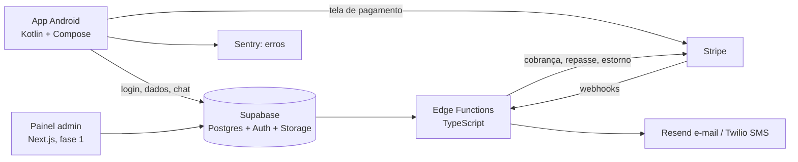

# Como tudo se conecta

Resumo técnico da [proposta de arquitetura](https://claude.ai/artifact/FTtcaBg7nRyZk88yBEwRmB).

## Quem faz o quê

| Peça | Responsabilidade | Fase |
|---|---|---|
| App Android | Telas; nunca decide valor, horário livre ou permissão sozinho | 0 (base), 1 |
| Banco (Postgres) | Guarda tudo, aplica segurança por usuário (RLS), impede horário duplicado, calcula comissão | 0 |
| Edge Functions | Falam com Stripe, e-mail e SMS usando chaves secretas | 1 |
| Stripe Connect | Recebe o pagamento, segura até depois do evento, repassa ao artista | 1 |
| Painel admin | Transações, cadastros, disputas, comunicados | 1 |

## Camadas do app

| Camada | Onde fica | Exemplo |
|---|---|---|
| UI (Compose) | `app/`, `core/designsystem/` | `WelcomeScreen`, `LudiusButton` |
| ViewModel | `app/` (fase 1) | estado da tela de busca |
| Domínio | `core/domain/` | `FeeCalculator`, `CancellationPolicy` |
| Dados | `core/data/` (fase 1) | repositórios que chamam o Supabase |

## Regras de ouro

1. **O app nunca é confiado.** Toda regra de dinheiro, agenda ou dado de outra pessoa é
   conferida no banco ou nas Edge Functions.
2. **Dinheiro em centavos** (número inteiro), nunca em decimal.
3. **Nenhum segredo no app.** O app só conhece a chave pública (`anon`) do Supabase.
4. **Um componente por elemento visual.** Telas reutilizam o design system.
