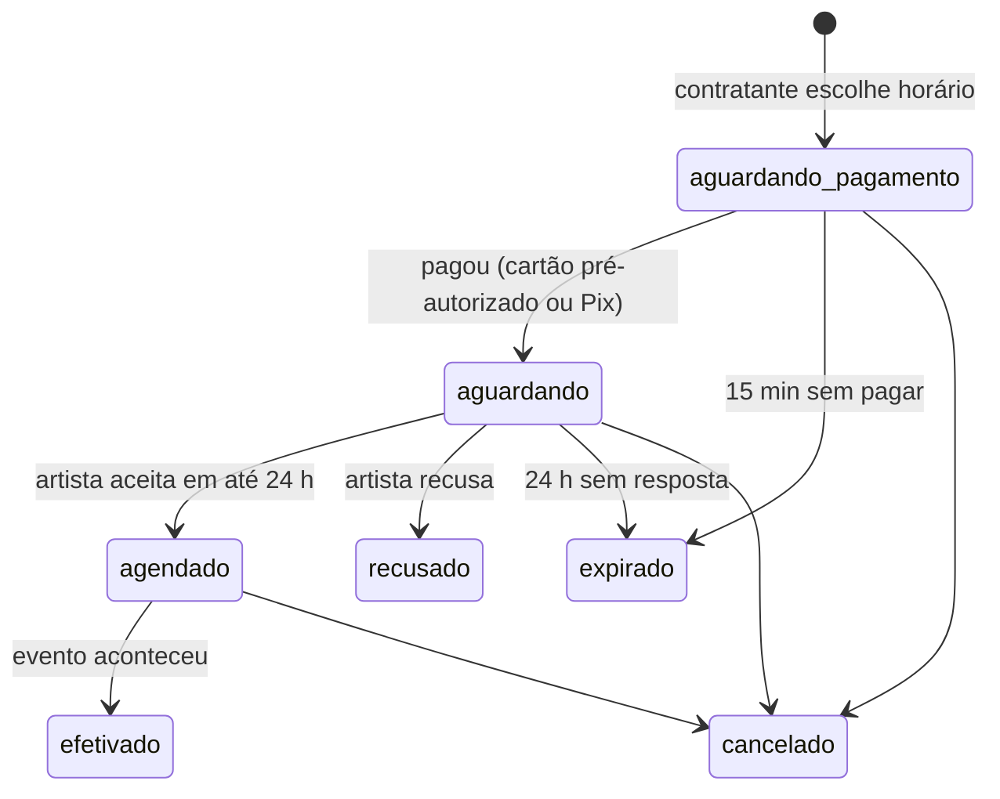

# Banco de dados

O que já existe no banco (fase 0) e como cada regra é garantida.

## Tabelas

| Tabela | O que guarda | Quem lê | Quem grava |
|---|---|---|---|
| `profiles` | Perfil público: @, nome artístico ou do negócio, bio, redes, gêneros | Logados (perfis completos) | O dono, só campos liberados |
| `personal_data` | Nome, nascimento, telefone, CPF/CNPJ, endereço | Só o dono | Só o dono |
| `consents` | Aceites de termos, privacidade e comunicados (com versão) | Só o dono | O dono, sem poder alterar depois |
| `services` | Serviços da vitrine: preço, duração, antecedência, intervalo | Logados (publicados) | Só artistas, os próprios |
| `availability_rules` | Horários semanais do artista | Logados | O artista |
| `availability_blocks` | Datas bloqueadas pelo artista | Logados | O artista |
| `favorites` | "Meus favoritos" do contratante | O dono | O dono |
| `orders` | Pedidos de contratação | As duas partes | **Só o servidor** |
| `order_events` | Histórico de cada mudança de status | As duas partes | Automático; ninguém altera |

## Regras garantidas pelo banco

| Regra | Como |
|---|---|
| Ninguém vê dados pessoais de outra pessoa | RLS em `personal_data` |
| Perfil nasce no cadastro com o tipo de conta | Gatilho `on_auth_user_created` |
| Só maiores de 18 anos | Gatilho `personal_data_adult` |
| CPF/CNPJ válido e único | Função `private.is_valid_tax_id` + `unique` |
| Usuário não muda a própria suspensão nem a etapa do cadastro | Permissão por coluna |
| Mesmo horário não é vendido duas vezes | Restrição `orders_no_overlap` (EXCLUDE) |
| Intervalo entre eventos respeitado | `blocked_range` = início até fim + intervalo |
| Valor e comissão vêm do serviço, nunca do app | Gatilho `orders_prepare` + `private.calc_fees` |
| Status segue a ordem certa | `private.order_transition_allowed` |
| Histórico de pedidos não pode ser apagado | Gatilho `order_events_immutable` |

## Ciclo do pedido

## Fica para a fase 1

- Chat, avaliações, notificações, chamados de suporte.
- Pagamentos (tabelas do Stripe), repasses e estornos.
- Funções para criar pedido, aceitar, recusar e cancelar (com a política de multas).
- Cálculo de horários livres e rotinas automáticas (pg_cron): expirar pedidos, marcar efetivados.
- Buckets de arquivos (fotos, rider, notas fiscais).
- Criptografia das colunas de dados pessoais (ver [ADR 0004](adr/0004-seguranca-dos-dados.md)).
